## Mục tiêu và bài toán

- Xấp xỉ hàm mật độ Gaussian 2 chiều bằng MLP: 2 đầu vào (x₁, x₂) → 1 đầu ra ŷ
- Miền x₁ ∈ [−2, 2], x₂ ∈ [−4, 4]; 0 ≤ y ≤ f_max ≈ 0.269
- Viết hoàn toàn bằng PyTorch (nn.Module, DataLoader, vòng lặp train tự viết)
- Khảo sát: **A** số mẫu train, **B** số nơ-ron (1 tầng), **C** số tầng ẩn
- Tự động hoá toàn bộ: `python run_all.py` (228 lần huấn luyện, 3 seed/cấu hình)

## Hàm Gaussian hai chiều

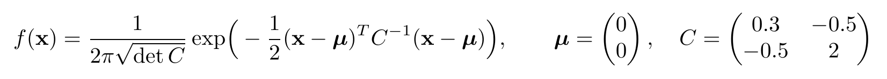

## Dữ liệu

::: columns
:::: column
- Lấy mẫu đều, seed 2024, không nhiễu
- Train 2000 · Val 200 · Test 100
- Nhóm A: A mẫu đầu của pool
- Chuẩn hoá theo miền → không rò rỉ
- y lệch phải: ~11% mẫu có y > 0.1
::::
:::: column
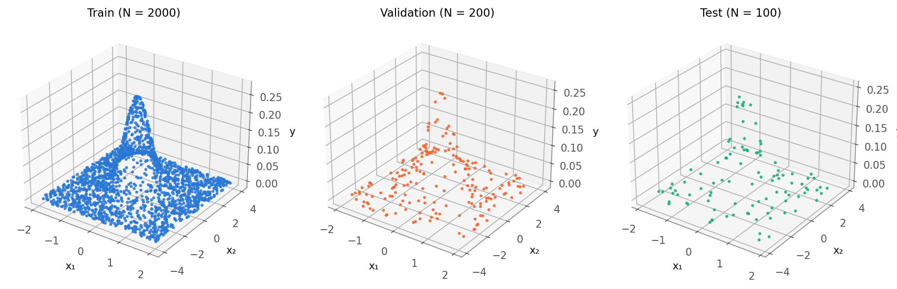
::::
:::

## Mô hình MLP và chương trình PyTorch

::: columns
:::: column
- `MLP(nn.Module)`, số tầng/nơ-ron tuỳ chọn
- DataLoader, MSELoss, Adam
- forward → loss → zero_grad → backward → step
- eval() + no_grad() cho validation
- Early stopping, checkpoint theo val loss
::::
:::: column
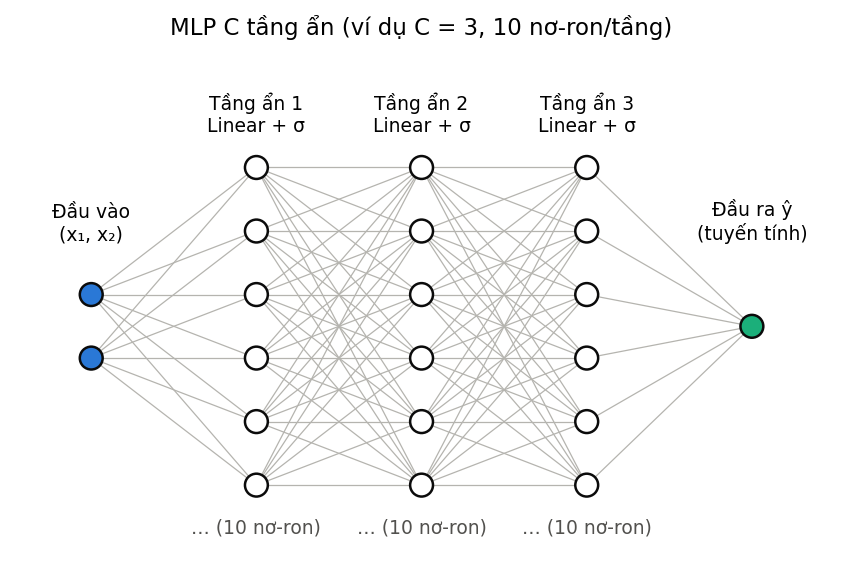
::::
:::

## Tự động tinh chỉnh siêu tham số

::: columns
:::: column
- Lưới: lr {0.001, 0.003, 0.01, 0.03} × {tanh, ReLU, sigmoid} × batch {32, 128}, 3 seed
- Chọn theo **val MSE** → **sigmoid, lr 0.01, batch 32**
- ReLU kém nhất với 10 nơ-ron (ít mảnh tuyến tính)
- Baseline: 1 tầng × 10, A = 1000, ≤ 3000 epoch
::::
:::: column
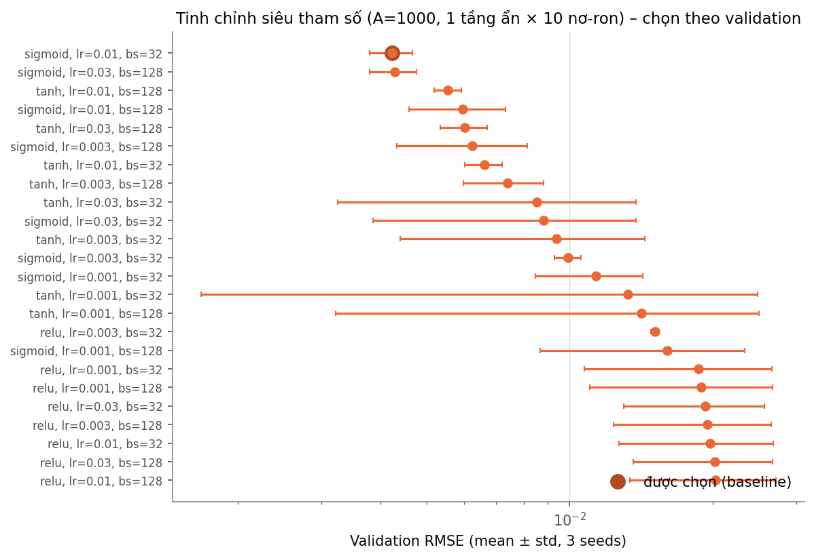
::::
:::

## Nhóm A – số mẫu huấn luyện

::: columns
:::: column
- A = 200 → 800: test RMSE 1.12e-02 → 4.00e-03
- A ≥ 800: bão hoà ≈ 4–5e-3, train ≈ test
- → giới hạn là **dung lượng mô hình** (10 nơ-ron), không phải dữ liệu
- A = 200: chỉ 26 mẫu gần đỉnh, phương sai giữa seed lớn
::::
:::: column
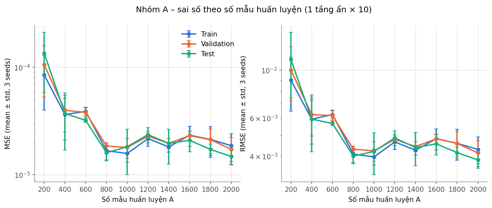
::::
:::

## Nhóm B – số nơ-ron tầng ẩn

::: columns
:::: column
- B = 1: R² = 0.0273 – thiếu khớp nặng
- B = 3: bắt đầu tạo được đỉnh; B ≥ 6: R² > 0.96
- B = 50: test RMSE 1.60e-03, lợi ích giảm dần
- A = 1000: không quá khớp; A = 200: khoảng cách val/train tăng tới ~1.4×
::::
:::: column
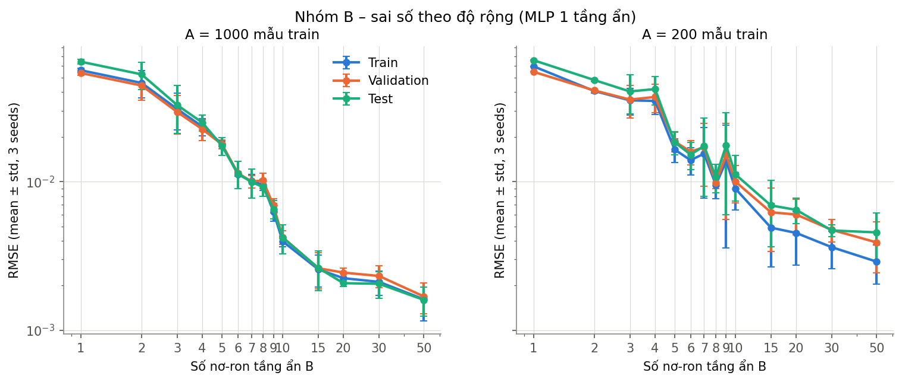
::::
:::

## Nhóm B – bề mặt xấp xỉ

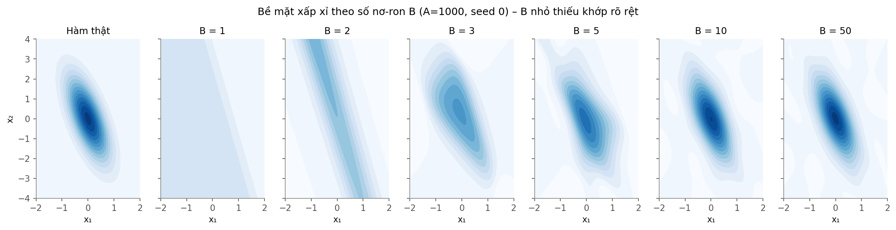

## Nhóm C – số tầng ẩn

::: columns
:::: column
- C = 1 → 2: test RMSE 4.21e-03 → 4.86e-04 (~9×)
- 2 × 10 (151 tham số) tốt hơn 1 × 50 (201 tham số) ~3×
- C = 4–5: ≈ 2e-4, lợi ích giảm dần
- Không thấy tiêu biến gradient đến 5 tầng (Adam)
::::
:::: column
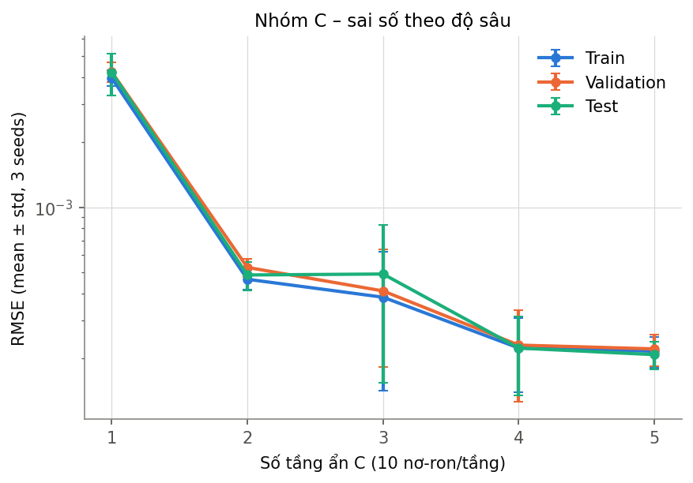
::::
:::

## Nhóm C – thời gian huấn luyện

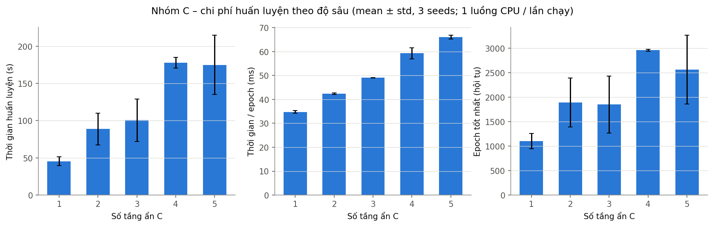

## Tinh chỉnh cuối và mô hình được chọn

::: columns
:::: column
- A = 2000; {10, 20, 40} nơ-ron × {2, 3, 4} tầng; ≤ 6000 epoch; chọn theo val
- Chọn: tầng ẩn **40-40-40-40**, 5081 tham số
- Test: MSE 1.21e-09, RMSE 3.47e-05, MAE 2.74e-05, R² = 0.9999997
::::
:::: column

::::
:::

## Minh hoạ mô hình xấp xỉ

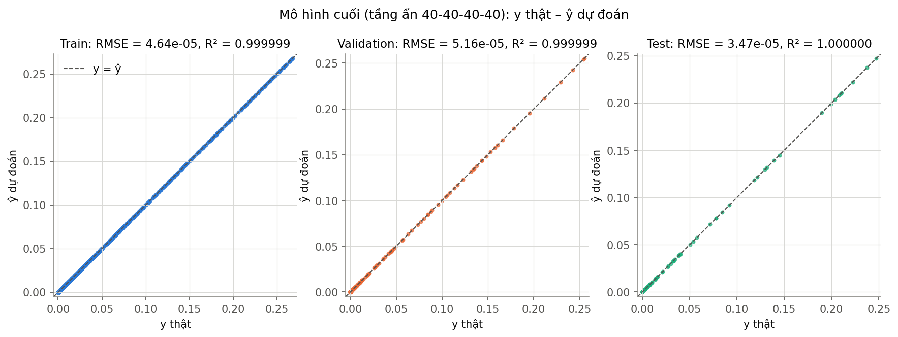

## Bề mặt xấp xỉ và sai số

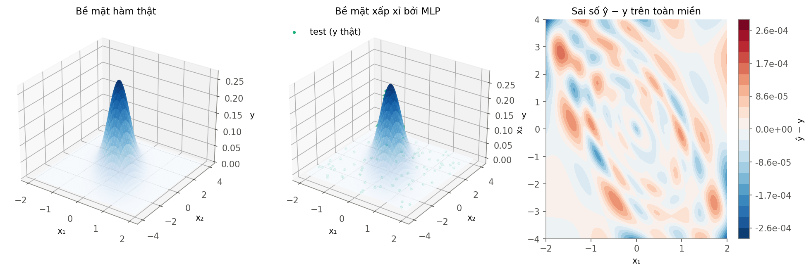

## Kết luận, hạn chế, hướng cải tiến

- Sai số chủ yếu do **thiếu khớp** → tăng dung lượng (nhất là **độ sâu**) hiệu quả hơn thêm dữ liệu khi A ≥ 800
- Cần B ≥ 3 để tạo đỉnh; quá khớp chỉ thấy rõ khi A = 200
- Hạn chế: dữ liệu không nhiễu, 3 seed, lr tinh chỉnh trên mạng 1 tầng
- Cải tiến: lr theo từng kiến trúc, lấy mẫu dày quanh đỉnh, thêm nhiễu
