# 1 Giới thiệu

## 1.1 Mục tiêu

Bài tập xây dựng và huấn luyện một mạng perceptron đa tầng (Multi-Layer Perceptron – MLP) bằng PyTorch để giải bài toán hồi quy: xấp xỉ một hàm mật độ Gaussian hai chiều. Ngoài việc huấn luyện được một mô hình tốt, mục tiêu chính là **thực nghiệm có kiểm soát** để trả lời ba câu hỏi:

* **A – Quy mô dữ liệu:** sai số thay đổi thế nào khi số mẫu huấn luyện A tăng từ 200 lên 2000?
* **B – Độ rộng:** với MLP một tầng ẩn, cần bao nhiêu nơ-ron B để không còn thiếu khớp, và khi nào xuất hiện quá khớp?
* **C – Độ sâu:** tăng số tầng ẩn C (giữ 10 nơ-ron/tầng) có làm sai số giảm không, và chi phí huấn luyện tăng ra sao?

## 1.2 Phát biểu bài toán

Cho hàm mật độ Gaussian hai chiều

$$f(\mathbf{x}) = \frac{1}{2\pi\sqrt{\det C}}\exp\left(-\frac{1}{2}(\mathbf{x}-\boldsymbol{\mu})^{T}C^{-1}(\mathbf{x}-\boldsymbol{\mu})\right),\qquad \boldsymbol{\mu}=\begin{pmatrix}0\\0\end{pmatrix},\quad C=\begin{pmatrix}0.3 & -0.5\\-0.5 & 2\end{pmatrix}.$$

Lấy ngẫu nhiên $\mathbf{x}=(x_1,x_2)$ trong miền $-2\le x_1\le 2$, $-4\le x_2\le 4$ với nhãn $y=f(x_1,x_2)$. Cần xây dựng MLP có 2 đầu vào và 1 đầu ra $\hat{y}$ sao cho $\hat{y}\approx y$, đánh giá trên một tập test độc lập 100 mẫu, và dùng một tập validation riêng để lựa chọn mô hình.

## 1.3 Nội dung thực hiện

Toàn bộ quy trình được tự động hoá bằng một lệnh `python run_all.py`:

1. Sinh dữ liệu cố định (seed 2024), lưu CSV, thống kê và trực quan hoá (mục 2).
2. Cài đặt MLP tuỳ biến bằng `torch.nn.Module`, vòng lặp train/validation viết tay, early stopping, checkpoint theo validation loss (mục 3).
3. **Tự động tinh chỉnh siêu tham số** (learning rate, hàm kích hoạt, batch size) bằng tìm kiếm lưới, chọn theo validation MSE; kết quả trở thành cấu hình chuẩn (baseline) cho mọi thực nghiệm.
4. Chạy ba nhóm thực nghiệm A, B, C (mỗi cấu hình 3 seed) và một thực nghiệm bổ sung B200 (nhóm B với A = 200) để quan sát quá khớp (mục 4).
5. **Tinh chỉnh cuối**: dựa trên kết luận A/B/C, tìm kiếm kiến trúc trên toàn bộ 2000 mẫu train, chọn theo validation; mô hình chọn được mới được đánh giá trên test (mục 4.6).
6. Tự sinh hình, bảng và tài liệu này từ log/CSV kết quả (mọi số liệu trong báo cáo truy vết được tới `results/*.csv`).

| Thành viên | MSSV | Nhiệm vụ | Tỷ lệ đóng góp |
|--------------|---------|------------------------------|-------|
| Nguyễn Phước Sang | 3123411255 | Trưởng nhóm; tích hợp pipeline, chọn mô hình cuối, báo cáo | 25% |
| Nguyễn Gia Thiệu | 3123411279 | Sinh dữ liệu, thống kê dữ liệu, thực nghiệm A | 25% |
| Trần Quốc An | 3123411009 | Thực nghiệm C, trực quan hoá, slide | 25% |
| Nguyễn Nguyên Chương | 3123411042 | Xây dựng MLP và vòng lặp huấn luyện PyTorch, thực nghiệm B | 25% |

# 2 Dữ liệu

## 2.1 Hàm Gaussian và tham số

Hàm `gaussian2d` (file `src/data.py`) cài đặt đúng công thức trên bằng NumPy: tính $\mathbf{d}=\mathbf{x}-\boldsymbol{\mu}$, khoảng cách Mahalanobis $\mathbf{d}^{T}C^{-1}\mathbf{d}$ bằng `np.einsum`, rồi chia cho $2\pi\sqrt{\det C}$. Hàm được kiểm tra với `scipy.stats.multivariate_normal.pdf` trên 1000 điểm ngẫu nhiên: sai khác tuyệt đối lớn nhất là $1.1\times10^{-16}$ (sai số làm tròn của số thực).

Với $\det C = 0.3\cdot 2 - (-0.5)^2 = 0.35$, giá trị cực đại của hàm tại $\boldsymbol\mu$ là $f_{max} = 1/(2\pi\sqrt{0.35}) \approx 0.2690$. Như vậy $0 \le y \le 0.269$; đề bài gốc (slide tiếng Anh) ghi $0\le y\le 1$ – đây chỉ là cận trên lỏng, chúng tôi không cắt hay co giãn dữ liệu theo cận này. Hiệp phương sai âm ($-0.5$) làm elip đồng mức nghiêng: $x_1$ và $x_2$ tương quan âm, nên hàm **không tách được** thành tích hai hàm một biến – mạng phải học được tương tác giữa hai đầu vào.

```python
def gaussian2d(x, mu=MU, cov=COV):
    d = x - mu
    inv = np.linalg.inv(cov)
    mahal = np.einsum("ni,ij,nj->n", d, inv, d)
    return np.exp(-0.5 * mahal) / (2.0 * np.pi * np.sqrt(np.linalg.det(cov)))
```

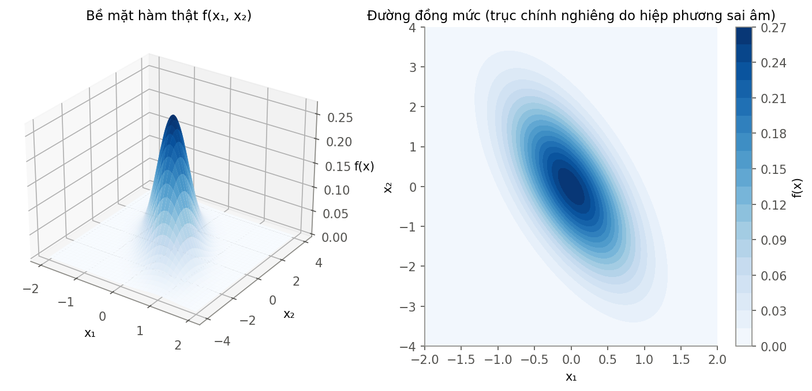{width=15cm}

## 2.2 Lấy mẫu và chia tập

* Lấy mẫu đều: $x_1\sim\mathcal{U}[-2,2]$, $x_2\sim\mathcal{U}[-4,4]$, nhãn $y=f(\mathbf{x})$ không nhiễu.
* Một bộ sinh `numpy.random.default_rng(2024)` sinh **lần lượt** ba tập độc lập: *train pool* 2000 mẫu, *validation* 200 mẫu, *test* 100 mẫu (lưu tại `data/train_pool.csv`, `data/valid.csv`, `data/test.csv`).
* Nhóm A dùng **A mẫu đầu tiên** của train pool, nên các tập nhỏ là tập con lồng nhau của tập lớn; nhóm B, C dùng A = 1000 mẫu đầu. Validation và test cố định cho mọi cấu hình, nên các so sánh là công bằng.
* **Không rò rỉ dữ liệu:** validation chỉ dùng cho early stopping, checkpoint và chọn siêu tham số/kiến trúc; test chỉ dùng để báo cáo kết quả cuối, không tham gia bất kỳ quyết định nào.
* **Chuẩn hoá** dựa trên miền đã biết chứ không dựa trên thống kê dữ liệu: $\tilde x_1=x_1/2$, $\tilde x_2=x_2/4$ (đưa về $[-1,1]$), $\tilde y=y/f_{max}$ (đưa về $[0,1]$). Mọi chỉ số MSE/RMSE/MAE trong báo cáo được tính lại trên **thang gốc** của $y$.

## 2.3 Thống kê và trực quan hoá

**Bảng 1.** Thống kê mô tả của ba tập dữ liệu (thang gốc).

| Tập | Biến | N | Min | Max | Mean | Std | Median |
|----------|---|----|---------|------|--------|-------|--------|
| Train pool | x₁ | 2000 | -1.998 | 1.999 | 0.03587 | 1.156 | 0.05486 |
| Train pool | x₂ | 2000 | -3.993 | 3.998 | -0.03611 | 2.299 | -0.05764 |
| Train pool | y | 2000 | 2.331e-13 | 0.2681 | 0.03172 | 0.05837 | 0.003478 |
| Validation | x₁ | 200 | -1.977 | 1.97 | -0.07271 | 1.161 | -0.09356 |
| Validation | x₂ | 200 | -3.874 | 3.994 | 0.07661 | 2.295 | 0.142 |
| Validation | y | 200 | 1.74e-11 | 0.2553 | 0.03071 | 0.05479 | 0.003078 |
| Test | x₁ | 100 | -1.923 | 1.872 | 0.1105 | 1.084 | 0.2667 |
| Test | x₂ | 100 | -3.859 | 3.877 | -0.1063 | 2.26 | -0.1711 |
| Test | y | 100 | 1.71e-10 | 0.2471 | 0.03904 | 0.0651 | 0.006602 |


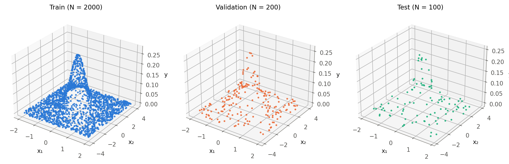{width=15cm}

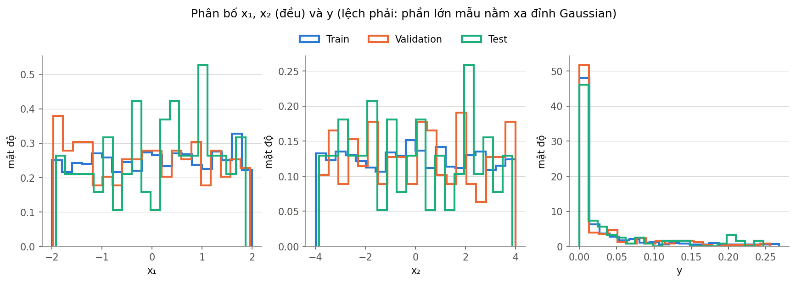{width=15cm}

$x_1$, $x_2$ phân bố đều như thiết kế. Phân bố của $y$ **lệch phải rất mạnh**: trung vị chỉ khoảng 0.003 trong khi giá trị lớn nhất là 0.27, vì đỉnh Gaussian chỉ chiếm một phần nhỏ của miền chữ nhật $[-2,2]\times[-4,4]$. Hệ quả: (i) phần lớn mẫu nằm ở vùng "phẳng" gần 0, mạng ít mẫu ở vùng đỉnh – nơi hàm cong nhất và khó học nhất; (ii) MSE tuyệt đối rất nhỏ (cỡ $10^{-5}$), vì vậy chúng tôi báo cáo thêm RMSE, MAE (cùng đơn vị với $y$) và $R^2$ để dễ diễn giải.

# 3 Mô hình và cài đặt

## 3.1 Kiến trúc MLP

Mạng nhận $\tilde{\mathbf{x}}\in\mathbb{R}^2$, đi qua $C$ tầng ẩn, mỗi tầng gồm một phép biến đổi affine và một hàm kích hoạt phi tuyến $\sigma$, rồi tới một nơ-ron đầu ra **tuyến tính** (không dùng sigmoid ở đầu ra như code mẫu, vì đây là bài toán hồi quy và đầu ra tuyến tính không bị bão hoà gần 0):

$$\mathbf{h}^{(0)}=\tilde{\mathbf{x}},\qquad \mathbf{h}^{(l)}=\sigma\left(W^{(l)}\mathbf{h}^{(l-1)}+\mathbf{b}^{(l)}\right),\ l=1,\dots,C,\qquad \hat{\tilde y}=\mathbf{w}^{(out)T}\mathbf{h}^{(C)}+b^{(out)}.$$

Với MLP một tầng ẩn $B$ nơ-ron, số tham số là $3B + (B+1) = 4B+1$; với $C$ tầng 10 nơ-ron là $30 + 110(C-1) + 11$.

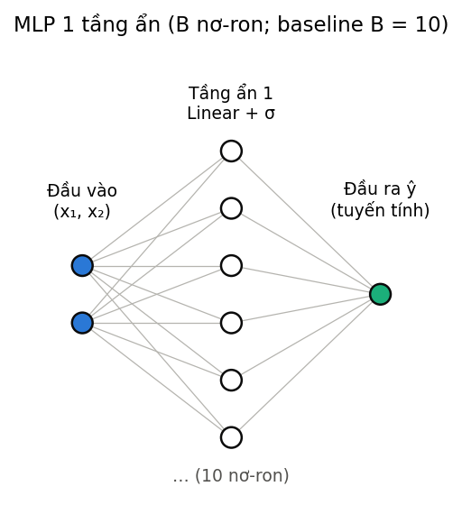{width=11cm}

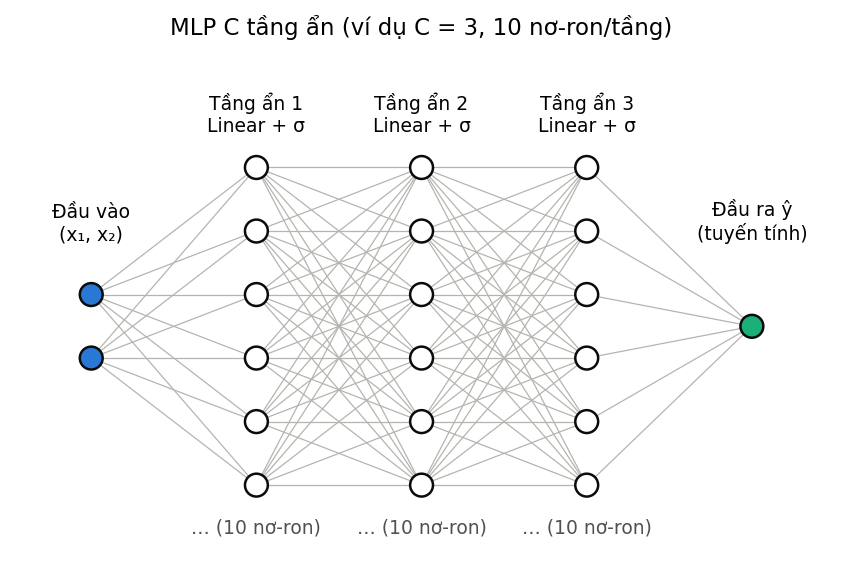{width=12cm}

Lớp `MLP` (file `src/model.py`) nhận danh sách số nơ-ron từng tầng `hidden_sizes` và tên hàm kích hoạt, nên cùng một lớp phục vụ cả ba nhóm A, B, C:

```python
class MLP(nn.Module):
    def __init__(self, hidden_sizes, activation="tanh", in_dim=2, out_dim=1):
        super().__init__()
        layers, prev = [], in_dim
        for h in hidden_sizes:
            layers += [nn.Linear(prev, h), ACTIVATIONS[activation]()]
            prev = h
        layers.append(nn.Linear(prev, out_dim))      # đầu ra tuyến tính
        self.net = nn.Sequential(*layers)

    def forward(self, x):
        return self.net(x)
```

## 3.2 Hàm mất mát và tối ưu

Hàm mất mát là sai số bình phương trung bình trên mini-batch $\mathcal{B}$ (`nn.MSELoss`), tính trên thang chuẩn hoá:

$$\mathcal{L}=\frac{1}{|\mathcal{B}|}\sum_{i\in\mathcal{B}}\left(\hat{\tilde y}_i-\tilde y_i\right)^2 .$$

Gradient được tính bằng lan truyền ngược (`loss.backward()`), cập nhật bằng Adam. Các chỉ số đánh giá trên thang gốc ($e_i=\hat y_i-y_i$, $N$ mẫu):

$$\mathrm{MSE}=\frac1N\sum e_i^2,\quad \mathrm{RMSE}=\sqrt{\mathrm{MSE}},\quad \mathrm{MAE}=\frac1N\sum|e_i|,\quad R^2=1-\frac{\sum e_i^2}{\sum (y_i-\bar y)^2}.$$

## 3.3 Vòng lặp huấn luyện

Dữ liệu được đóng gói bằng `TensorDataset` và `DataLoader` (xáo trộn bằng `torch.Generator` có seed). Mỗi epoch gồm vòng lặp train (forward → loss → `zero_grad` → `backward` → `optimizer.step`) ở chế độ `model.train()`, sau đó đánh giá validation ở chế độ `model.eval()` trong `torch.no_grad()`:

```python
def run_epoch(model, loader, loss_fn, device, optimizer=None):
    training = optimizer is not None
    model.train(training)
    with torch.set_grad_enabled(training):
        for xb, yb in loader:
            pred = model(xb)                 # forward
            loss = loss_fn(pred, yb)         # MSE
            if training:
                optimizer.zero_grad()        # xoá gradient cũ
                loss.backward()              # backpropagation
                optimizer.step()             # cập nhật trọng số
            ...

for epoch in range(1, max_epochs + 1):
    train_loss = run_epoch(model, train_loader, loss_fn, device, optimizer)
    model.eval()
    with torch.no_grad():
        val_loss = loss_fn(model(xv), yv).item()
    scheduler.step(val_loss)                               # ReduceLROnPlateau
    if val_loss < best_val * (1 - 1e-4):                   # cải thiện → checkpoint
        best_val, best_epoch, wait = val_loss, epoch, 0
        best_state = copy.deepcopy(model.state_dict())
    else:
        wait += 1
        if wait >= patience: break                         # early stopping
```

Sau khi dừng, trọng số tốt nhất theo validation được nạp lại, lưu vào `best.pt`, và mô hình được đánh giá trên train/validation/test. Loss theo epoch được ghi vào `log.csv`, các chỉ số vào `metrics.json` của từng lần chạy.

## 3.4 Thiết lập chung và môi trường

**Bảng 2.** Cấu hình huấn luyện chung (baseline) cho mọi thực nghiệm.

| Thành phần | Giá trị |
|---------------------|---------------------------------------------------------------------------------------------------------------------------|
| Optimizer | Adam (β₁ = 0.9, β₂ = 0.999) |
| Learning rate | 0.01 (chọn bằng tinh chỉnh; lưới: lr: {0.001, 0.003, 0.01, 0.03}; activation: {tanh, relu, sigmoid}; batch_size: {32, 128}) |
| Hàm kích hoạt tầng ẩn | sigmoid (chọn bằng tinh chỉnh) |
| Batch size | 32 (chọn bằng tinh chỉnh) |
| Đầu ra | 1 nơ-ron tuyến tính |
| Kiến trúc baseline | 1 tầng ẩn × 10 nơ-ron, A = 1000 mẫu train |
| Hàm mất mát | MSELoss (trên y chuẩn hoá y / f_max) |
| Số epoch tối đa | 3000 |
| Điều kiện dừng | early stopping: val loss không giảm ≥ 0.0001 (tương đối) sau 200 epoch |
| Lịch learning rate | ReduceLROnPlateau: ×0.5 sau 50 epoch không cải thiện, lr tối thiểu 1e-05 |
| Checkpoint | trọng số có val loss nhỏ nhất (best.pt) |
| Khởi tạo trọng số | mặc định của nn.Linear (Kaiming-uniform) |
| Seeds | dữ liệu: 2024; huấn luyện: 0, 1, 2 |


* **Môi trường:** Python 3.10, PyTorch 2.13, NumPy 2.2, Pandas, SciPy, Matplotlib. Các mạng rất nhỏ (41 – 5 081 tham số) nên chạy trên CPU nhanh hơn GPU; mỗi lần chạy dùng **1 luồng CPU** (`torch.set_num_threads(1)`) và nhiều lần chạy song song bằng `ProcessPoolExecutor`.
* **Tái lập:** seed dữ liệu 2024; seed huấn luyện 0, 1, 2 (khởi tạo trọng số và thứ tự mini-batch). Mỗi cấu hình chạy 3 seed, báo cáo **trung bình ± độ lệch chuẩn**.
* Lưu ý: số epoch tối đa như nhau nhưng số bước cập nhật mỗi epoch là $\lceil A/32 \rceil$, nên tập lớn hơn nhận nhiều bước cập nhật hơn; cột "Số bước cập nhật" trong Bảng A ghi lại điều này.

# 4 Thực nghiệm

## 4.1 Quy trình đánh giá công bằng

1. **Cố định dữ liệu:** mọi cấu hình dùng cùng file CSV, cùng validation (200) và test (100). Nhóm A thay đổi số mẫu bằng cách lấy tiền tố của cùng một pool.
2. **Một biến mỗi nhóm:** nhóm A chỉ đổi A; nhóm B chỉ đổi B (A = 1000, 1 tầng ẩn); nhóm C chỉ đổi C (A = 1000, 10 nơ-ron/tầng). Mọi siêu tham số khác lấy từ baseline (Bảng 2).
3. **Ba seed** cho mỗi cấu hình; báo cáo trung bình ± độ lệch chuẩn để phân biệt xu hướng thật với dao động do khởi tạo.
4. **Lựa chọn chỉ dựa trên validation:** siêu tham số (mục 4.2) và kiến trúc cuối (mục 4.6) đều chọn bằng val MSE trung bình. Cột test trong các bảng chỉ để báo cáo.
5. **Lưu đầy đủ:** mỗi lần chạy có `config.json`, `log.csv`, `best.pt`, `metrics.json` trong `runs/<nhóm>/<cấu hình>_s<seed>/`; bảng tổng hợp trong `results/<nhóm>_runs.csv` và `results/<nhóm>_summary.csv`.

Tổng cộng có 72 lần chạy tinh chỉnh, 30 (A) + 42 (B) + 42 (B200) + 15 (C) + 27 (tinh chỉnh cuối) = 228 lần huấn luyện.

## 4.2 Tự động tinh chỉnh siêu tham số

Trước khi chạy A/B/C, chương trình tìm kiếm lưới trên các siêu tham số "phụ" – những yếu tố **không** phải là biến khảo sát: learning rate $\in\{0.001, 0.003, 0.01, 0.03\}$, hàm kích hoạt $\in$ {tanh, ReLU, sigmoid}, batch size $\in\{32, 128\}$ (24 tổ hợp × 3 seed), trên cấu hình baseline (A = 1000, 1 tầng ẩn × 10 nơ-ron). Lưới ban đầu chỉ có lr tới 0.01; vì tổ hợp tốt nhất nằm đúng biên lưới, chương trình được chạy thêm lr = 0.03 để chắc chắn điểm tối ưu không nằm ngoài lưới. Số nơ-ron và số tầng **không** được tinh chỉnh ở bước này vì chúng là biến độc lập của B và C.

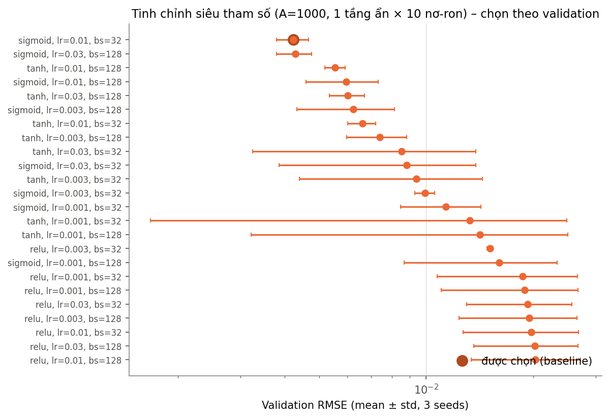{width=14cm}

**Bảng 3.** Kết quả tinh chỉnh siêu tham số, sắp xếp theo val MSE (thang gốc).

| Activation | lr | Batch | Val MSE | Val RMSE | Best epoch |
|-------|-----|---|-------------------|-------------------|-----------|
| sigmoid | 0.01 | 32 | 1.80e-05 ± 3.76e-06 | 4.23e-03 ± 4.33e-04 | 1103 ± 153 |
| sigmoid | 0.03 | 128 | 1.84e-05 ± 4.03e-06 | 4.28e-03 ± 4.79e-04 | 909 ± 95 |
| tanh | 0.01 | 128 | 3.08e-05 ± 3.93e-06 | 5.54e-03 ± 3.61e-04 | 1197 ± 414 |
| tanh | 0.03 | 128 | 3.66e-05 ± 8.41e-06 | 6.02e-03 ± 6.91e-04 | 740 ± 120 |
| sigmoid | 0.01 | 128 | 3.67e-05 ± 1.72e-05 | 5.95e-03 ± 1.36e-03 | 1367 ± 330 |
| sigmoid | 0.003 | 128 | 4.13e-05 ± 2.58e-05 | 6.24e-03 ± 1.91e-03 | 2989 ± 10 |
| tanh | 0.01 | 32 | 4.40e-05 ± 7.80e-06 | 6.61e-03 ± 6.05e-04 | 787 ± 413 |
| tanh | 0.003 | 128 | 5.61e-05 ± 2.04e-05 | 7.40e-03 ± 1.42e-03 | 2094 ± 787 |
| tanh | 0.03 | 32 | 9.13e-05 ± 1.06e-04 | 8.53e-03 ± 5.28e-03 | 917 ± 607 |
| sigmoid | 0.03 | 32 | 9.41e-05 ± 1.00e-04 | 8.81e-03 ± 4.96e-03 | 892 ± 90 |
| sigmoid | 0.003 | 32 | 9.89e-05 ± 1.26e-05 | 9.93e-03 ± 6.29e-04 | 1942 ± 429 |
| tanh | 0.003 | 32 | 1.05e-04 ± 1.08e-04 | 9.40e-03 ± 5.00e-03 | 1432 ± 1361 |
| sigmoid | 0.001 | 32 | 1.35e-04 ± 6.96e-05 | 1.14e-02 ± 2.88e-03 | 2601 ± 680 |
| relu | 0.003 | 32 | 2.30e-04 ± 9.12e-06 | 1.51e-02 ± 3.01e-04 | 322 ± 284 |
| tanh | 0.001 | 32 | 2.66e-04 ± 3.85e-04 | 1.33e-02 ± 1.16e-02 | 986 ± 565 |
| tanh | 0.001 | 128 | 2.80e-04 ± 3.75e-04 | 1.41e-02 ± 1.09e-02 | 2257 ± 1267 |
| sigmoid | 0.001 | 128 | 2.94e-04 ± 2.07e-04 | 1.60e-02 ± 7.37e-03 | 2998 ± 3 |
| relu | 0.001 | 32 | 3.92e-04 ± 3.33e-04 | 1.87e-02 ± 7.95e-03 | 521 ± 123 |
| relu | 0.001 | 128 | 3.99e-04 ± 3.32e-04 | 1.89e-02 ± 7.87e-03 | 969 ± 168 |
| relu | 0.03 | 32 | 4.01e-04 ± 2.69e-04 | 1.93e-02 ± 6.36e-03 | 392 ± 136 |
| relu | 0.003 | 128 | 4.14e-04 ± 3.06e-04 | 1.95e-02 ± 7.11e-03 | 513 ± 254 |
| relu | 0.01 | 32 | 4.25e-04 ± 3.05e-04 | 1.98e-02 ± 7.08e-03 | 230 ± 41 |
| relu | 0.03 | 128 | 4.37e-04 ± 2.91e-04 | 2.02e-02 ± 6.60e-03 | 211 ± 44 |
| relu | 0.01 | 128 | 4.43e-04 ± 2.96e-04 | 2.03e-02 ± 6.89e-03 | 222 ± 119 |


Tổ hợp được chọn là **sigmoid, lr = 0.01, batch size = 32** (val RMSE 4.23e-03). Nhận xét:

* **Sigmoid tốt nhất, ReLU kém nhất** với mạng một tầng 10 nơ-ron: mọi tổ hợp ReLU đều có val RMSE trên $1.4\times10^{-2}$, gấp 3–5 lần sigmoid/tanh. Hàm đích trơn và có dạng "quả chuông"; hiệu của hai sigmoid lệch nhau tạo ra một "gờ" trơn, nên tổ hợp vài sigmoid xấp xỉ quả chuông rất tự nhiên, trong khi ReLU chỉ ghép được các mảnh tuyến tính và với 10 nơ-ron thì số mảnh quá ít (thêm nữa, nơ-ron ReLU "chết" làm giảm dung lượng hiệu dụng).
* **lr nhỏ (0.001) không đủ** trong giới hạn 3000 epoch: nhiều lần chạy chạm trần epoch hoặc mắc ở vùng phẳng của loss (độ lệch chuẩn rất lớn giữa các seed). lr = 0.01–0.03 cho kết quả ổn định nhất.
* Hai tổ hợp đứng đầu (sigmoid lr 0.01/bs 32 và sigmoid lr 0.03/bs 128) chênh nhau không đáng kể so với độ lệch chuẩn; điều này hợp lý vì tỉ lệ lr/batch size của chúng gần nhau.

## 4.3 Nhóm A – ảnh hưởng của số mẫu huấn luyện

**Thiết lập:** A $\in$ {200, 400, …, 2000}; MLP 1 tầng ẩn × 10 nơ-ron (41 tham số); các siêu tham số khác theo baseline; 3 seed.

**Bảng 4.** Nhóm A – sai số theo số mẫu huấn luyện (mean ± std, 3 seed, thang gốc).

| A | Train RMSE ×10⁻³ | Val RMSE ×10⁻³ | Test RMSE ×10⁻³ | Test MAE ×10⁻³ | Test MSE | Test R² | Best epoch | Số bước cập nhật |
|----|-----------|------------|------------|-----------|--------|-------|-----|--------|
| 200 | 8.98 ± 2.52 | 10.02 ± 2.81 | 11.20 ± 3.77 | 8.09 ± 2.47 | 1.35e-04 | 0.96817 | 1133 | 9333 |
| 400 | 5.93 ± 1.37 | 6.23 ± 1.27 | 5.93 ± 1.75 | 4.69 ± 1.50 | 3.73e-05 | 0.99121 | 1792 | 25892 |
| 600 | 6.23 ± 0.29 | 6.16 ± 0.33 | 5.66 ± 0.12 | 4.33 ± 0.07 | 3.21e-05 | 0.99243 | 1225 | 27069 |
| 800 | 4.09 ± 0.35 | 4.31 ± 0.15 | 4.00 ± 0.31 | 3.12 ± 0.41 | 1.61e-05 | 0.99621 | 1178 | 34442 |
| 1000 | 3.97 ± 0.33 | 4.23 ± 0.43 | 4.21 ± 0.93 | 3.40 ± 0.78 | 1.83e-05 | 0.99569 | 1103 | 41707 |
| 1200 | 4.65 ± 0.36 | 4.78 ± 0.11 | 4.86 ± 0.38 | 3.82 ± 0.37 | 2.37e-05 | 0.99441 | 730 | 35340 |
| 1400 | 4.26 ± 0.22 | 4.43 ± 0.24 | 4.38 ± 0.77 | 3.31 ± 0.80 | 1.96e-05 | 0.99537 | 1152 | 59473 |
| 1600 | 4.82 ± 0.53 | 4.81 ± 0.22 | 4.56 ± 0.51 | 3.51 ± 0.43 | 2.10e-05 | 0.99506 | 662 | 43100 |
| 1800 | 4.58 ± 0.75 | 4.58 ± 0.59 | 4.15 ± 0.26 | 3.05 ± 0.30 | 1.73e-05 | 0.99592 | 881 | 61636 |
| 2000 | 4.30 ± 0.61 | 4.14 ± 0.56 | 3.84 ± 0.32 | 2.98 ± 0.21 | 1.48e-05 | 0.99650 | 750 | 59829 |


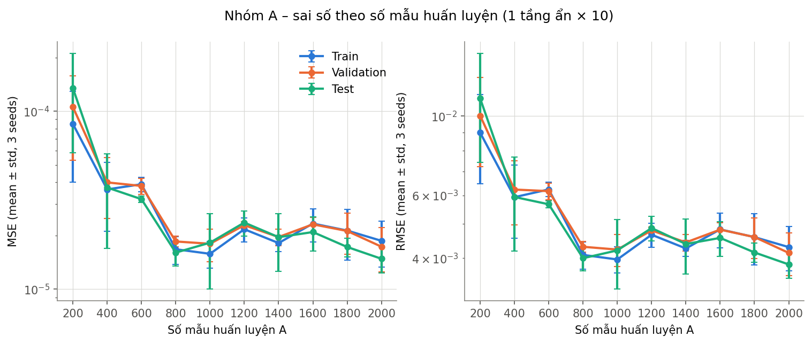{width=15cm}

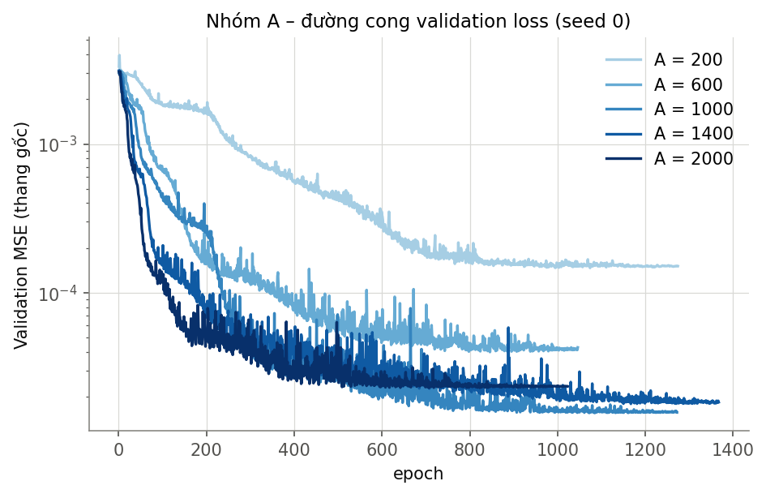{width=12cm}

**Nhận xét:**

* **Giai đoạn thiếu dữ liệu (A ≤ 800):** test RMSE giảm từ 1.12e-02 (A = 200) xuống 4.00e-03 (A = 800), tức gần 3 lần; độ lệch chuẩn giữa các seed cũng giảm mạnh (từ 3.77e-03 xuống 3.09e-04). Với A = 200, chỉ 26 mẫu (13%) có $y > 0.1$ – vùng đỉnh, nơi hàm cong nhất, được lấy mẫu rất thưa – nên mạng nội suy kém ở vùng này và kết quả phụ thuộc nhiều vào khởi tạo. Đây cũng là cấu hình duy nhất có test RMSE cao hơn rõ rệt train RMSE (1.12e-02 so với 8.98e-03).
* **Giai đoạn bão hoà (A ≥ 800):** sai số đi ngang quanh $4\text{–}5\times10^{-3}$, và train ≈ validation ≈ test. Vì sai số trên chính tập train không giảm nữa, giới hạn lúc này là **dung lượng của mô hình 10 nơ-ron (thiếu khớp/bias)** chứ không phải thiếu dữ liệu: thêm mẫu không giúp một mô hình đã không khớp nổi dữ liệu train. Kết luận này được xác nhận ở nhóm B và C, nơi tăng dung lượng làm sai số giảm thêm hàng chục lần.
* **Không đơn điệu:** A = 1200 và 1600 cho sai số hơi cao hơn A = 1000. Các chênh lệch này nằm trong khoảng 1–2 độ lệch chuẩn giữa các seed, nên là dao động do tối ưu hoá (điểm dừng của early stopping, cực tiểu cục bộ) chứ không phải xu hướng thật.
* **Yếu tố gây nhiễu số bước cập nhật:** cùng trần 3000 epoch nhưng số bước mỗi epoch là $\lceil A/32\rceil$, nên tập lớn nhận nhiều bước cập nhật hơn (cột cuối Bảng 4, từ khoảng 9 nghìn bước ở A = 200 tới khoảng 60 nghìn bước ở A = 2000). Ngược lại, early stopping dừng sớm hơn (tính theo epoch) khi A lớn. Vì A ≥ 800 đã bão hoà dù số bước còn tiếp tục tăng, yếu tố này không thay đổi kết luận.

## 4.4 Nhóm B – ảnh hưởng của số nơ-ron tầng ẩn

**Thiết lập:** MLP 1 tầng ẩn, B $\in$ {1, …, 10} và mở rộng {15, 20, 30, 50}; A = 1000; baseline; 3 seed. Bổ sung **B200**: cùng lưới B nhưng chỉ A = 200 mẫu train, để tạo tình huống số tham số xấp xỉ số mẫu (B = 50 có 201 tham số) và quan sát quá khớp.

**Bảng 5.** Nhóm B – sai số theo số nơ-ron tầng ẩn, A = 1000 (mean ± std, 3 seed).

| B | Train RMSE ×10⁻³ | Val RMSE ×10⁻³ | Test RMSE ×10⁻³ | Test MAE ×10⁻³ | Test MSE | Test R² | Số tham số |
|---|------------|------------|-------------|------------|--------|-------|-----|
| 1 | 56.20 ± 1.84 | 53.84 ± 1.70 | 64.17 ± 2.40 | 42.08 ± 3.55 | 4.12e-03 | 0.02728 | 5 |
| 2 | 46.19 ± 9.60 | 44.36 ± 9.07 | 52.74 ± 11.02 | 33.15 ± 9.75 | 2.86e-03 | 0.32453 | 9 |
| 3 | 30.85 ± 8.50 | 29.46 ± 8.45 | 32.79 ± 11.72 | 21.50 ± 5.68 | 1.17e-03 | 0.72459 | 13 |
| 4 | 23.48 ± 3.12 | 22.56 ± 3.63 | 24.99 ± 2.99 | 18.04 ± 3.53 | 6.30e-04 | 0.85128 | 17 |
| 5 | 17.95 ± 0.72 | 17.83 ± 1.26 | 17.43 ± 2.42 | 13.11 ± 1.04 | 3.08e-04 | 0.92737 | 21 |
| 6 | 11.21 ± 0.32 | 11.42 ± 0.33 | 11.32 ± 2.37 | 8.36 ± 1.69 | 1.32e-04 | 0.96889 | 25 |
| 7 | 10.10 ± 1.07 | 10.04 ± 0.99 | 9.95 ± 2.22 | 7.48 ± 2.07 | 1.02e-04 | 0.97585 | 29 |
| 8 | 9.51 ± 0.77 | 10.18 ± 1.18 | 9.20 ± 1.21 | 6.90 ± 1.19 | 8.57e-05 | 0.97979 | 33 |
| 9 | 6.28 ± 0.86 | 6.92 ± 0.76 | 6.53 ± 0.93 | 5.11 ± 0.47 | 4.33e-05 | 0.98979 | 37 |
| 10 | 3.97 ± 0.33 | 4.23 ± 0.43 | 4.21 ± 0.93 | 3.40 ± 0.78 | 1.83e-05 | 0.99569 | 41 |
| 15 | 2.57 ± 0.62 | 2.62 ± 0.72 | 2.63 ± 0.78 | 2.05 ± 0.57 | 7.32e-06 | 0.99827 | 61 |
| 20 | 2.24 ± 0.17 | 2.44 ± 0.17 | 2.07 ± 0.11 | 1.63 ± 0.08 | 4.31e-06 | 0.99898 | 81 |
| 30 | 2.12 ± 0.40 | 2.32 ± 0.39 | 2.05 ± 0.42 | 1.62 ± 0.35 | 4.34e-06 | 0.99898 | 121 |
| 50 | 1.62 ± 0.46 | 1.69 ± 0.39 | 1.60 ± 0.36 | 1.25 ± 0.25 | 2.65e-06 | 0.99937 | 201 |


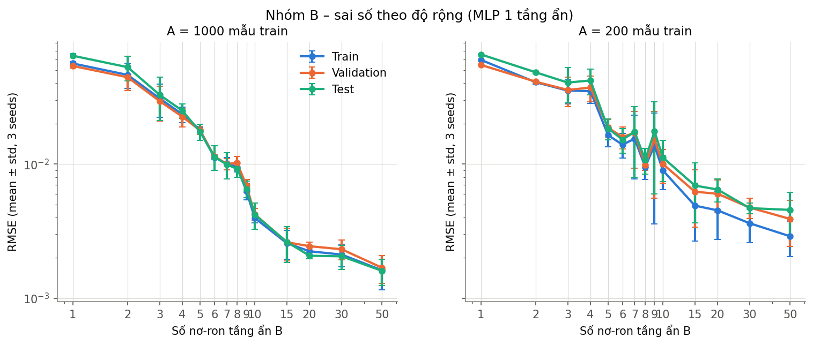{width=15cm}

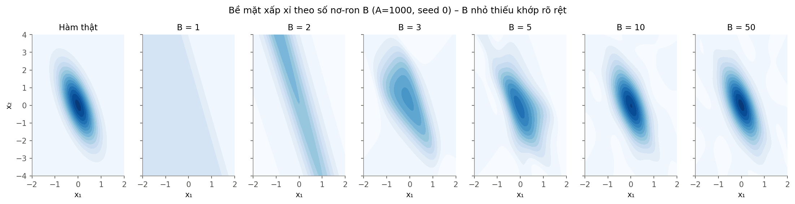{width=15cm}

**Thiếu khớp (B nhỏ).** Một nơ-ron sigmoid chỉ biểu diễn được hàm dạng $\sigma(\mathbf{w}^T\mathbf{x}+b)$ – đơn điệu theo một hướng, không thể tạo một "đỉnh" – nên B = 1 gần như chỉ dự đoán hằng số: $R^2$ = 0.0273, test RMSE 6.42e-02. Với B = 2, hai sigmoid tạo được một "dải" chạy dọc trục chính của elip nhưng không khép lại ($R^2$ = 0.3245). Từ B = 3 mạng mới tạo được một đỉnh khép kín ($R^2$ = 0.7246), và từ B = 6 thì $R^2$ > 0.96. Hình 10 cho thấy rõ quá trình này. Ở mọi B, train ≈ validation ≈ test: sai số nằm ở chính dữ liệu train, đúng đặc trưng thiếu khớp.

**Lợi ích giảm dần (B lớn).** Test RMSE giảm từ 4.21e-03 (B = 10) xuống 2.07e-03 (B = 20) nhưng chỉ còn 2.05e-03 ở B = 30 và 1.60e-03 ở B = 50. Mỗi lần gấp đôi số tham số chỉ mang lại cải thiện nhỏ.

**Quá khớp.** Với A = 1000 **không quan sát thấy quá khớp** kể cả khi B = 50: hàm đích không có nhiễu, số mẫu (1000) lớn gấp 5 lần số tham số (201) và early stopping chặn quá trình học ở điểm tốt nhất theo validation.

**Bảng 6.** Thực nghiệm bổ sung B200 – nhóm B với A = 200 mẫu train.

| B | Train RMSE ×10⁻³ | Val RMSE ×10⁻³ | Test RMSE ×10⁻³ | Test MAE ×10⁻³ | Test MSE | Test R² | Số tham số |
|---|-------------|------------|-------------|------------|--------|--------|-----|
| 1 | 59.74 ± 0.07 | 54.83 ± 0.01 | 65.65 ± 0.06 | 43.92 ± 0.21 | 4.31e-03 | -0.01714 | 5 |
| 2 | 40.75 ± 1.20 | 41.13 ± 0.25 | 48.29 ± 0.72 | 33.68 ± 0.82 | 2.33e-03 | 0.44960 | 9 |
| 3 | 35.26 ± 7.28 | 35.68 ± 8.95 | 40.48 ± 11.94 | 27.45 ± 8.24 | 1.73e-03 | 0.59095 | 13 |
| 4 | 34.95 ± 6.70 | 37.15 ± 8.15 | 41.98 ± 9.21 | 29.85 ± 5.51 | 1.82e-03 | 0.57073 | 17 |
| 5 | 16.44 ± 3.02 | 18.65 ± 2.84 | 18.43 ± 3.32 | 13.92 ± 3.12 | 3.47e-04 | 0.91811 | 21 |
| 6 | 13.95 ± 2.91 | 15.93 ± 2.97 | 15.22 ± 3.19 | 11.56 ± 2.28 | 2.39e-04 | 0.94372 | 25 |
| 7 | 15.45 ± 7.71 | 17.05 ± 7.73 | 17.37 ± 9.39 | 12.90 ± 7.28 | 3.61e-04 | 0.91493 | 29 |
| 8 | 9.52 ± 1.84 | 9.83 ± 0.85 | 10.74 ± 2.30 | 8.34 ± 1.53 | 1.19e-04 | 0.97193 | 33 |
| 9 | 13.76 ± 10.19 | 15.13 ± 9.58 | 17.54 ± 11.53 | 12.91 ± 8.22 | 3.96e-04 | 0.90648 | 37 |
| 10 | 8.98 ± 2.52 | 10.02 ± 2.81 | 11.20 ± 3.77 | 8.09 ± 2.47 | 1.35e-04 | 0.96817 | 41 |
| 15 | 4.90 ± 2.24 | 6.22 ± 2.84 | 6.92 ± 3.26 | 5.04 ± 2.34 | 5.49e-05 | 0.98704 | 61 |
| 20 | 4.52 ± 1.77 | 6.01 ± 1.61 | 6.46 ± 1.25 | 4.58 ± 1.45 | 4.28e-05 | 0.98989 | 81 |
| 30 | 3.62 ± 1.02 | 4.74 ± 0.82 | 4.70 ± 0.45 | 3.44 ± 0.59 | 2.22e-05 | 0.99476 | 121 |
| 50 | 2.90 ± 0.85 | 3.90 ± 1.48 | 4.56 ± 1.62 | 3.30 ± 1.09 | 2.25e-05 | 0.99469 | 201 |


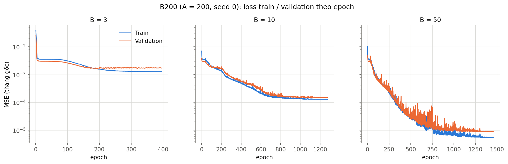{width=15cm}

Với A = 200 (Bảng 6), dấu hiệu quá khớp xuất hiện: tỉ số val RMSE / train RMSE (trung bình qua các seed) xấp xỉ 1.0 khi B ≤ 3, tăng lên khoảng 1.1 khi B = 5–10 và 1.3–1.4 khi B ≥ 20. Train RMSE vẫn giảm đều theo B (từ 8.98e-03 ở B = 10 xuống 2.90e-03 ở B = 50), nhưng test RMSE gần như dừng giảm từ B = 30 (4.70e-03) đến B = 50 (4.56e-03): phần dung lượng tăng thêm chủ yếu dùng để khớp các điểm train chứ không cải thiện khả năng tổng quát hoá. Sai số không tăng trở lại (không có dạng chữ U điển hình) vì dữ liệu không nhiễu và early stopping theo validation dừng trước khi mô hình kịp "học thuộc". Một số điểm không đơn điệu (B = 4, 7, 9 khi A = 200) có độ lệch chuẩn rất lớn: một seed rơi vào cực tiểu cục bộ xấu, các seed còn lại bình thường.

## 4.5 Nhóm C – ảnh hưởng của số tầng ẩn

**Thiết lập:** C $\in$ {1, 2, 3, 4, 5} tầng ẩn, mỗi tầng 10 nơ-ron; A = 1000; baseline; 3 seed. Để thời gian huấn luyện so sánh được, 15 lần chạy của nhóm C được chạy riêng, mỗi lần chạy trên một tiến trình 1 luồng CPU, không chạy chung với nhóm khác. Thời gian đo bằng `time.perf_counter()` cho toàn bộ vòng lặp train + validation.

**Bảng 7.** Nhóm C – sai số theo số tầng ẩn (mean ± std, 3 seed).

| C | Train RMSE ×10⁻³ | Val RMSE ×10⁻³ | Test RMSE ×10⁻³ | Test MAE ×10⁻³ | Test MSE | Test R² | Số tham số |
|---|-----------|-----------|-----------|-----------|--------|-------|-----|
| 1 | 3.97 ± 0.33 | 4.23 ± 0.43 | 4.21 ± 0.93 | 3.40 ± 0.78 | 1.83e-05 | 0.99569 | 41 |
| 2 | 0.46 ± 0.05 | 0.53 ± 0.05 | 0.49 ± 0.07 | 0.37 ± 0.06 | 2.40e-07 | 0.99994 | 151 |
| 3 | 0.38 ± 0.24 | 0.41 ± 0.23 | 0.49 ± 0.34 | 0.35 ± 0.21 | 3.17e-07 | 0.99993 | 261 |
| 4 | 0.22 ± 0.08 | 0.23 ± 0.10 | 0.22 ± 0.09 | 0.18 ± 0.07 | 5.50e-08 | 0.99999 | 371 |
| 5 | 0.22 ± 0.03 | 0.22 ± 0.04 | 0.21 ± 0.03 | 0.16 ± 0.03 | 4.40e-08 | 0.99999 | 481 |


**Bảng 8.** Nhóm C – hội tụ và thời gian huấn luyện.

| C | Số tham số | Best epoch | Số epoch đã chạy | ms / epoch | Tổng thời gian (s) |
|---|-----|----------|----------|----------|------------|
| 1 | 41 | 1103 ± 153 | 1303 ± 153 | 34.8 ± 0.5 | 45.4 ± 6.0 |
| 2 | 151 | 1894 ± 500 | 2094 ± 500 | 42.4 ± 0.3 | 88.7 ± 21.5 |
| 3 | 261 | 1850 ± 580 | 2050 ± 580 | 49.0 ± 0.1 | 100.5 ± 28.5 |
| 4 | 371 | 2959 ± 17 | 3000 ± 0 | 59.2 ± 2.3 | 177.7 ± 7.0 |
| 5 | 481 | 2563 ± 704 | 2650 ± 606 | 66.0 ± 0.8 | 174.9 ± 39.8 |


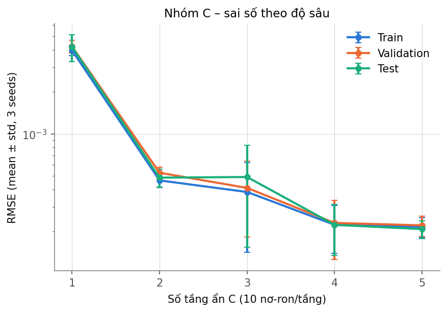{width=12cm}

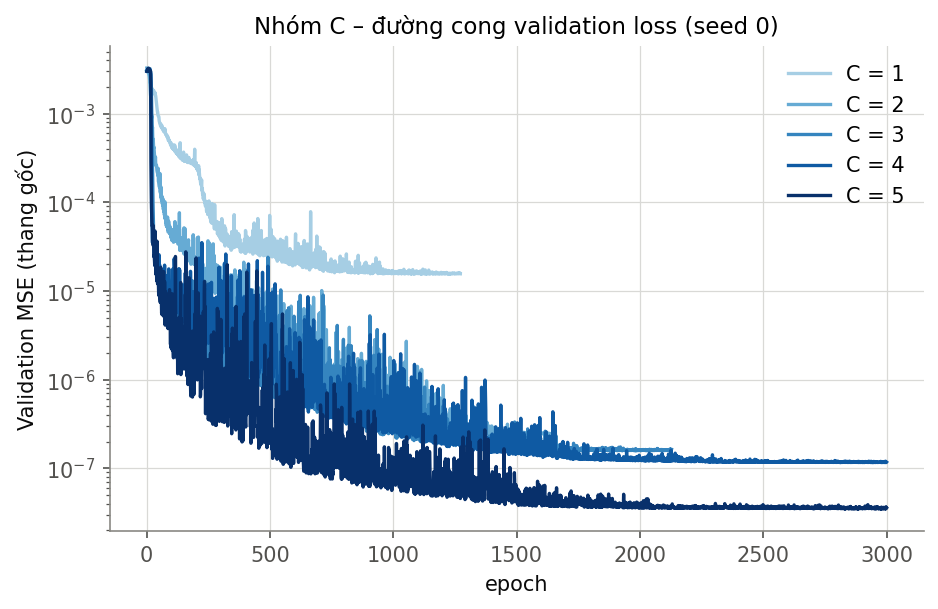{width=12cm}

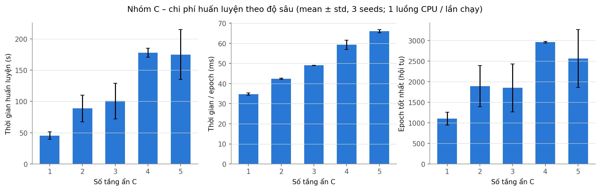{width=15cm}

**Nhận xét:**

* **Tầng thứ hai mang lại bước nhảy lớn nhất:** test RMSE giảm từ 4.21e-03 (C = 1) xuống 4.86e-04 (C = 2), gần **9 lần**, trong khi số tham số chỉ tăng từ 41 lên 151. Đáng chú ý, mạng 2 tầng × 10 nơ-ron (151 tham số) tốt hơn khoảng 3 lần mạng **1 tầng × 50 nơ-ron** (201 tham số, test RMSE 1.60e-03). Như vậy độ sâu dùng tham số hiệu quả hơn độ rộng với hàm này: tầng 1 tạo các đặc trưng "gờ" theo nhiều hướng, tầng 2 kết hợp phi tuyến chúng thành một đỉnh khép kín – phù hợp với cấu trúc hợp thành của $\exp(-\tfrac12 \cdot \text{dạng toàn phương})$.
* **Tiếp tục tăng độ sâu:** C = 3 có trung bình tương đương C = 2 (4.91e-04) nhưng độ lệch chuẩn lớn (một seed kém hơn hẳn); C = 4 và C = 5 giảm tiếp xuống khoảng 2.23e-04 và 2.08e-04 ($R^2$ > 0.9999). Lợi ích giảm dần sau C = 2.
* **Không thấy hiện tượng tiêu biến gradient** trong phạm vi 5 tầng, dù dùng sigmoid. Báo cáo mẫu (TensorFlow, gradient descent thuần, khởi tạo phân phối chuẩn) kết luận rằng tăng số tầng làm loss tăng do tiêu biến gradient; kết quả của chúng tôi khác vì (i) Adam chuẩn hoá bước cập nhật theo độ lớn gradient của từng tham số, bù lại gradient nhỏ ở các tầng đầu, (ii) khởi tạo mặc định của `nn.Linear` có thang đo theo số đầu vào, (iii) mạng chỉ sâu tối đa 5 tầng. Tuy nhiên đường cong validation (Hình 13) cho thấy mạng sâu dao động mạnh hơn nhiều trước khi ReduceLROnPlateau giảm learning rate – lr = 0.01 được chọn cho mạng 1 tầng là hơi lớn đối với mạng sâu.
* **Chi phí:** thời gian mỗi epoch tăng gần tuyến tính theo số tầng (từ 34.8 ms lên 66 ms; với mạng nhỏ như vậy phần lớn chi phí là overhead cố định của PyTorch cho mỗi lớp/lô dữ liệu). Tổng thời gian tăng nhanh hơn (khoảng 4 lần từ C = 1 đến C = 4–5) vì mạng sâu cần nhiều epoch hơn để hội tụ. C = 4 và C = 5 gần như **chạm trần 3000 epoch** (best epoch ≈ 2960 với C = 4), nên sai số của chúng có thể còn giảm nữa nếu cho chạy lâu hơn; điều này được xét lại ở bước tinh chỉnh cuối với trần 6000 epoch.
* Thời gian đo có thể dao động theo tải của hệ thống; vì vậy chúng tôi báo cáo cả thời gian mỗi epoch (ổn định, độ lệch chuẩn ≤ 2.3 ms) bên cạnh tổng thời gian.

## 4.6 Tinh chỉnh cuối và mô hình được chọn

Kết quả A, B, C cho thấy sai số của baseline bị chi phối bởi **dung lượng mô hình**: thêm dữ liệu sau 800 mẫu không giúp, còn tăng độ rộng và đặc biệt là **độ sâu** làm sai số giảm hàng chục lần; đồng thời C = 4–5 chạm trần 3000 epoch. Từ đó bước tinh chỉnh cuối được thiết kế tự động như sau:

* Dùng **toàn bộ 2000 mẫu** train pool (nhóm A cho thấy thêm dữ liệu không làm xấu đi, và mạng lớn hơn cần nhiều dữ liệu hơn).
* Lưới kiến trúc: {10, 20, 40} nơ-ron/tầng × {2, 3, 4} tầng ẩn (bỏ 1 tầng vì C đã cho thấy kém hơn hẳn), 3 seed.
* Trần epoch tăng lên **6000**; các siêu tham số khác giữ theo baseline.
* Chọn kiến trúc có **val MSE trung bình nhỏ nhất**; trong 3 seed của kiến trúc đó, chọn seed có val MSE nhỏ nhất làm mô hình nộp (`models/final_model.pt`). Test chỉ được dùng sau bước này.

**Bảng 9.** Tinh chỉnh cuối (A = 2000) – validation MSE/RMSE của 9 kiến trúc, sắp xếp theo val MSE.

| Nơ-ron/tầng | Số tầng | Số tham số | Val MSE | Val RMSE |
|-----|---|-----|-------------------|-------------------|
| 40 | 4 | 5081 | 4.32e-09 ± 1.89e-09 | 6.47e-05 ± 1.42e-05 |
| 40 | 3 | 3441 | 8.26e-09 ± 4.09e-09 | 8.91e-05 ± 2.21e-05 |
| 20 | 4 | 1341 | 1.08e-08 ± 4.29e-09 | 1.02e-04 ± 2.13e-05 |
| 20 | 3 | 921 | 1.21e-08 ± 6.71e-09 | 1.07e-04 ± 2.90e-05 |
| 40 | 2 | 1801 | 1.27e-08 ± 1.22e-08 | 1.04e-04 ± 5.40e-05 |
| 10 | 4 | 371 | 1.78e-08 ± 1.28e-08 | 1.28e-04 ± 4.54e-05 |
| 20 | 2 | 501 | 2.53e-08 ± 1.18e-08 | 1.56e-04 ± 3.72e-05 |
| 10 | 3 | 261 | 3.50e-08 ± 1.10e-08 | 1.85e-04 ± 3.05e-05 |
| 10 | 2 | 151 | 7.75e-08 ± 1.32e-08 | 2.78e-04 ± 2.35e-05 |


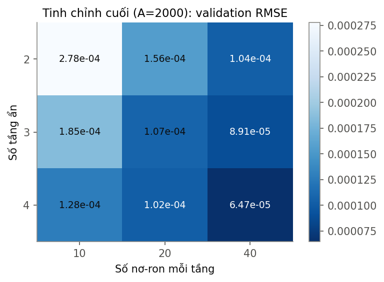{width=11cm}

**Kết quả.** Kiến trúc có val MSE trung bình nhỏ nhất là **4 tầng ẩn × 40 nơ-ron** (5 081 tham số): val RMSE 6.47e-05 ± 1.42e-05, test RMSE trung bình 3 seed 5.76e-05. So với baseline 1 tầng × 10 nơ-ron (test RMSE 4.21e-03), sai số giảm khoảng 70 lần. Trong lưới, sai số giảm đều khi tăng cả độ rộng lẫn độ sâu. Mạng 2 tầng × 10 nơ-ron với A = 2000 và trần 6000 epoch đạt test RMSE 2.62e-04, giảm gần một nửa so với cùng kiến trúc ở nhóm C (A = 1000, trần 3000 epoch: 4.86e-04): khi mô hình đủ dung lượng, thêm dữ liệu và thời gian huấn luyện lại có ích.

Trong 3 seed của kiến trúc được chọn, seed 0 có val MSE nhỏ nhất và được lưu làm mô hình nộp. Test RMSE của riêng seed này (3.47e-05) thấp hơn trung bình 3 seed (5.76e-05). Con số trung bình là ước lượng khách quan hơn cho hiệu năng của **kiến trúc**, còn con số của seed 0 là hiệu năng của **file mô hình** được nộp.

**Lưu ý.** Kiến trúc được chọn nằm ở **biên lưới** (rộng nhất và sâu nhất), và cả 3 seed có best epoch từ 5931 đến 5976, sát trần 6000. Một mạng lớn hơn hoặc huấn luyện lâu hơn có thể còn tốt hơn. Chúng tôi dừng ở đây vì mỗi lần chạy đã mất khoảng 12 phút, lợi ích đã giảm dần (với 40 nơ-ron, đi từ 3 lên 4 tầng chỉ giảm val RMSE từ 8.91e-05 xuống 6.47e-05), và sai số hiện tại chỉ khoảng 0.02% của $f_{max}$.

**Sai số trên toàn miền.** Trên lưới 201 × 201 điểm phủ toàn miền, sai số tuyệt đối lớn nhất của mô hình cuối là $2.9\times10^{-4}$ (khoảng 0.1% của $f_{max}$), trung bình $3.6\times10^{-5}$. Sai số lớn nhất nằm sát **biên miền**, nơi mạng ít mẫu lân cận ở một phía; bên trong vùng $|x_1|<1.8,\ |x_2|<3.6$ sai số lớn nhất chỉ $1.7\times10^{-4}$. Bản đồ sai số có dạng gợn sóng dọc theo hướng elip, đặc trưng của tổng các hàm sigmoid.

**Bảng 10.** Mô hình cuối – chỉ số trên train / validation / test (thang gốc).

| Tập | MSE | RMSE | MAE | R² |
|-----|---------|---------|---------|---------|
| train | 2.149e-09 | 4.636e-05 | 3.452e-05 | 0.9999994 |
| val | 2.664e-09 | 5.162e-05 | 3.653e-05 | 0.9999991 |
| test | 1.207e-09 | 3.474e-05 | 2.744e-05 | 0.9999997 |


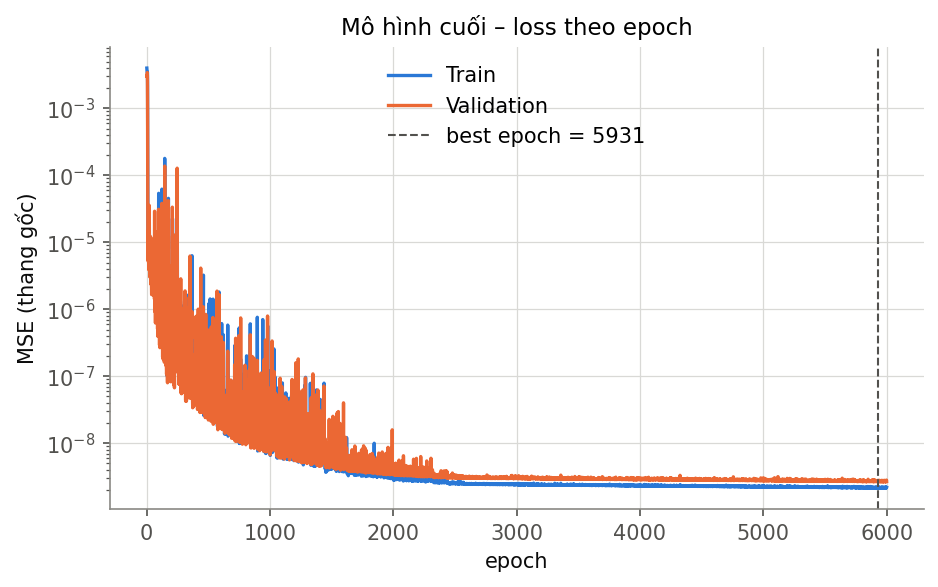{width=12cm}

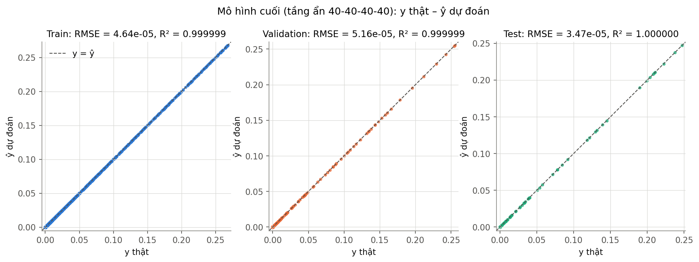{width=15cm}

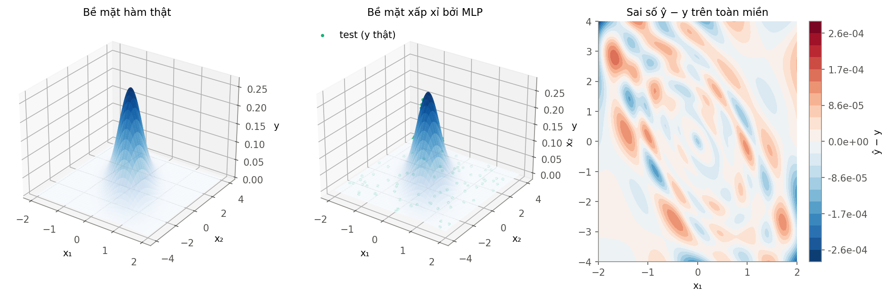{width=15cm}

# 5 Thảo luận

## 5.1 Tổng hợp xu hướng

* **Sai số chủ yếu đến từ thiếu khớp, không phải quá khớp.** Trong hầu hết thực nghiệm, sai số train ≈ validation ≈ test. Khi đó cách hiệu quả nhất để giảm sai số là tăng dung lượng mô hình chứ không phải thêm dữ liệu. Thêm dữ liệu chỉ có ích rõ ràng ở vùng A ≤ 800, khi vùng đỉnh của Gaussian còn được lấy mẫu quá thưa.
* **Độ sâu hiệu quả hơn độ rộng.** Mạng 2 tầng × 10 nơ-ron (151 tham số) tốt hơn khoảng 3 lần mạng 1 tầng × 50 nơ-ron (201 tham số). Điều này phù hợp với các kết quả lý thuyết về lợi ích của độ sâu: hàm hợp $\exp(-q(\mathbf{x}))$ với $q$ là dạng toàn phương được biểu diễn gọn hơn bởi một chuỗi phép biến đổi phi tuyến so với một tổ hợp tuyến tính các hàm sigmoid một chiều.
* **Lợi ích giảm dần.** Cả theo độ rộng (sau B ≈ 15–20) lẫn độ sâu (sau C = 2), mỗi lần tăng gấp đôi số tham số chỉ mang lại cải thiện nhỏ hơn, trong khi thời gian huấn luyện tăng.
* **Chọn mô hình theo validation hoạt động tốt:** tương quan hạng Spearman giữa val MSE và test MSE trung bình của các cấu hình là 0.99 (tune), 0.93 (A), 0.99 (B), 0.98 (B200) và 0.90 (C), tức thứ tự theo validation gần như trùng thứ tự theo test; validation 200 mẫu đủ tin cậy để lựa chọn mà không cần nhìn vào test.

## 5.2 Các trường hợp không như kỳ vọng

* **Nhóm A không đơn điệu** (A = 1200, 1600 kém hơn A = 1000): do dao động tối ưu hoá giữa các seed; chênh lệch nằm trong 1–2 độ lệch chuẩn.
* **Không thấy quá khớp kiểu chữ U** kể cả khi số tham số ≈ số mẫu (B200, B = 50): dữ liệu không có nhiễu nên "khớp sát dữ liệu train" cũng gần như là khớp đúng hàm thật; early stopping theo validation còn chặn trước. Dấu hiệu quá khớp chỉ thể hiện qua khoảng cách train–validation tăng và test RMSE ngừng giảm.
* **Không thấy tiêu biến gradient** với 5 tầng sigmoid, trái với nhận xét trong báo cáo mẫu: Adam và khởi tạo hợp lý của PyTorch khắc phục được với độ sâu nhỏ. Tuy nhiên mạng sâu hội tụ chậm hơn và dao động mạnh hơn với cùng learning rate.
* **ReLU kém nhất** ở bước tinh chỉnh, trong khi ReLU thường là lựa chọn mặc định của học sâu: với mạng rất nhỏ và hàm đích trơn, các hàm kích hoạt trơn (sigmoid, tanh) phù hợp hơn.
* **Một số seed rơi vào cực tiểu cục bộ** (ví dụ C = 3 seed 2, B200 với B = 4, 7, 9), làm độ lệch chuẩn lớn. Đây là lý do chạy nhiều seed là cần thiết; chỉ chạy 1 seed có thể dẫn tới kết luận sai.

## 5.3 Hạn chế

* Dữ liệu không nhiễu, nên khó khảo sát quá khớp theo nghĩa thông thường; kết luận về quá khớp chỉ áp dụng cho bài toán nội suy hàm trơn.
* Chỉ 3 seed cho mỗi cấu hình; một số khác biệt nhỏ (đặc biệt trong nhóm A khi A ≥ 800) không có ý nghĩa thống kê.
* Siêu tham số (lr, activation, batch size) được tinh chỉnh trên mạng 1 tầng × 10 rồi dùng chung cho mọi cấu hình; learning rate tối ưu của mạng sâu/rộng có thể khác, nên nhóm C và bước tinh chỉnh cuối có thể chưa đạt sai số tốt nhất có thể.
* Trần 3000 epoch làm C = 4–5 chưa hội tụ hẳn; so sánh độ sâu vì vậy hơi thiệt cho mạng sâu.
* Ở bước tinh chỉnh cuối, kiến trúc tốt nhất nằm ở biên lưới và vẫn sát trần 6000 epoch, nên chưa chắc đã là kiến trúc tối ưu.
* Cùng số epoch nhưng khác số bước cập nhật giữa các giá trị A.
* Thời gian đo có thể dao động theo tải của hệ thống.

## 5.4 Đề xuất cải tiến

* Tinh chỉnh learning rate (và lịch giảm lr, ví dụ cosine annealing) **riêng cho từng kiến trúc**, hoặc dùng tìm kiếm Bayes (Optuna) thay cho lưới.
* Lấy mẫu dày hơn ở vùng đỉnh (importance sampling theo $f$) hoặc dùng hàm mất mát có trọng số, vì phần lớn sai số tập trung quanh đỉnh và dọc trục chính của elip.
* Thêm nhiễu vào nhãn để khảo sát quá khớp và vai trò của regularization (weight decay, dropout).
* Với mạng rất nhỏ, thử bộ tối ưu bậc hai (L-BFGS) có thể đạt sai số thấp hơn nhiều lần so với Adam.
* Tăng số seed (≥ 5) và kiểm định thống kê khi so sánh các cấu hình gần nhau.

# 6 Kết luận

Chúng tôi đã xây dựng một quy trình PyTorch hoàn chỉnh và tự động – sinh dữ liệu, MLP tuỳ biến, vòng lặp train/validation tự viết với early stopping và checkpoint, tinh chỉnh siêu tham số theo validation, ba nhóm thực nghiệm có kiểm soát với 3 seed, và bước tinh chỉnh cuối – để xấp xỉ hàm Gaussian hai chiều. Các kết luận chính:

1. **Số mẫu (A):** sai số giảm khoảng 3 lần khi A tăng từ 200 lên 800, sau đó bão hoà vì mô hình 10 nơ-ron đã bị giới hạn bởi dung lượng.
2. **Độ rộng (B):** cần ít nhất 3 nơ-ron sigmoid để tạo được "đỉnh"; B = 1–4 thiếu khớp rõ rệt; sai số giảm đều tới B = 50 nhưng lợi ích giảm dần. Quá khớp chỉ xuất hiện (nhẹ) khi dữ liệu ít (A = 200).
3. **Độ sâu (C):** thêm tầng ẩn thứ hai giảm sai số khoảng 9 lần và hiệu quả hơn tăng độ rộng với cùng số tham số; đổi lại thời gian mỗi epoch tăng tuyến tính và cần nhiều epoch hơn để hội tụ.
4. **Mô hình cuối:** MLP với tầng ẩn 40-40-40-40 (5081 tham số), chọn hoàn toàn bằng validation, đạt trên tập test MSE = 1.21e-09, RMSE = 3.47e-05, MAE = 2.74e-05, $R^2$ = 0.9999997 (trung bình 3 seed của kiến trúc này: test RMSE 5.76e-05) – sai số nhỏ hơn khoảng 70 lần so với baseline 1 tầng × 10 nơ-ron.

# 7 Tài liệu tham khảo

1. I. Goodfellow, Y. Bengio, A. Courville. *Deep Learning*. MIT Press, 2016 – chương 6 (Deep Feedforward Networks), chương 7 (Regularization, early stopping), chương 8 (Optimization).
2. D. P. Kingma, J. Ba. Adam: A Method for Stochastic Optimization. *ICLR*, 2015.
3. G. Cybenko. Approximation by superpositions of a sigmoidal function. *Mathematics of Control, Signals and Systems*, 2(4):303–314, 1989.
4. K. Hornik. Approximation capabilities of multilayer feedforward networks. *Neural Networks*, 4(2):251–257, 1991.
5. R. Eldan, O. Shamir. The Power of Depth for Feedforward Neural Networks. *COLT*, 2016.
6. X. Glorot, Y. Bengio. Understanding the difficulty of training deep feedforward neural networks. *AISTATS*, 2010.
7. L. Prechelt. Early Stopping – But When? In *Neural Networks: Tricks of the Trade*, Springer, 1998.
8. A. Paszke et al. PyTorch: An Imperative Style, High-Performance Deep Learning Library. *NeurIPS*, 2019; tài liệu https://pytorch.org/docs/stable/.
9. Tài liệu học phần Học sâu: *MLP_Exercise* (Function Approximation MLP), *Sample_Code*, *Sample_Report*.

# 8 Phụ lục – Lệnh tái lập và cấu trúc mã nguồn

Cài đặt và chạy lại toàn bộ (thời gian chạy phụ thuộc số nhân CPU; bước tinh chỉnh cuối chiếm nhiều thời gian nhất):

```bash
pip install -r requirements.txt
python run_all.py                         # data → tune → A → B → B200 → C → final → plots → tables
python report/build.py                    # báo cáo .docx/.pdf và slide .pptx/.pdf
```

Chạy riêng từng thực nghiệm: `python run_all.py --stages A` (tương tự `tune`, `B`, `B200`, `C`, `final`, `plots`, `tables`). Các lần chạy đã có `metrics.json` được bỏ qua, nên có thể chạy tiếp sau khi bị ngắt.

| File | Chức năng |
|---|---|
| `src/data.py` | Hàm Gaussian 2D, sinh/lưu/nạp CSV, chuẩn hoá, `DataLoader` |
| `src/model.py` | Lớp `MLP(nn.Module)` tuỳ biến số tầng, số nơ-ron, hàm kích hoạt |
| `src/train.py` | Vòng lặp train/validation, early stopping, ReduceLROnPlateau, checkpoint, log CSV |
| `src/evaluate.py` | Dự đoán và các chỉ số MSE, RMSE, MAE, $R^2$ trên thang gốc |
| `src/experiments.py` | Định nghĩa các nhóm tune/A/B/B200/C/final, chạy song song, tổng hợp mean ± std, chọn baseline và mô hình cuối |
| `src/plots.py`, `src/tables.py` | Sinh toàn bộ hình và bảng từ log/CSV |
| `run_all.py` | Điều phối toàn bộ quy trình |
| `report/build.py` | Ghép báo cáo/slide từ template, tự đánh số hình/bảng, chèn số liệu từ CSV |

Kết quả từng lần chạy: `runs/<nhóm>/<cấu hình>_s<seed>/{config.json, log.csv, best.pt, metrics.json}`; tổng hợp: `results/<nhóm>_runs.csv`, `results/<nhóm>_summary.csv`; mô hình cuối: `models/final_model.pt`.
